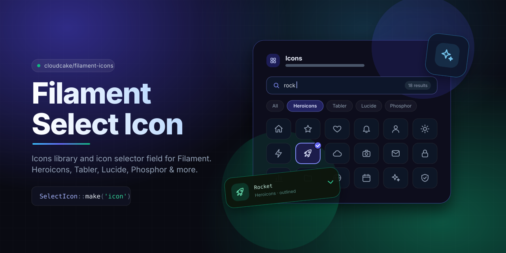

# Installation

Register the composer repository:

```json
// composer.json

"repositories": [
    {
        "type": "composer",
        "url": "https://composer.cloudcake.dev"
    }
]
```

Install the package:

`composer require cloudcake/filament-icons`

## Usage

### Icon enums

Each installed icon set has a backed enum in `Cloudcake\Icons\Enums` that works anywhere Filament takes an icon: `Tabler`, `HeroIcon`, `FontAwesome`, `Lucide`, `Material` and `Phosphor`.

```php
use Cloudcake\Icons\Enums\Tabler;

protected static string|BackedEnum|null $navigationIcon = Tabler::Cube;
```

### Dynamic icons

`Cloudcake\Icons\Enums\Icon` refers to any icon from any installed set by name, without an enum case.

```php
use Cloudcake\Icons\Enums\Icon;

Icon::make('heroicon-o-users');
Icon::heroicon('users', 'outlined');
Icon::tabler('user-key');
Icon::lucide('badge-check');
Icon::material('account-circle');
Icon::phosphor('whatsapp-logo', 'duotone');
Icon::fontawesome('house', 'solid');
```

### The icon picker field

`Cloudcake\Icons\SelectIcon` is a Filament form field that opens a searchable modal of every installed icon.

```php
use Cloudcake\Icons\SelectIcon;

SelectIcon::make('icon')
    ->allowedSets(['tabler', 'heroicons'])
    ->searchable()
    ->placeholder('Choose an icon')
    ->modalSize('4xl');
```

| Method | What it does |
| --- | --- |
| `allowedSets(array\|Closure\|null)` | Limits the picker to these icon sets, by Blade Icons set name (for example `tabler`, `heroicons`, `lucide`, `phosphor-icons`, `fontawesome-solid`). Every installed set by default. |
| `searchable(bool\|Closure)` | Whether the modal has a search box. On by default. |
| `placeholder(string\|Closure\|null)` | The text on the trigger before an icon is chosen. |
| `modalSize(string\|Closure\|null)` | `sm` to `7xl`, or `full`. Defaults to `4xl`. |
